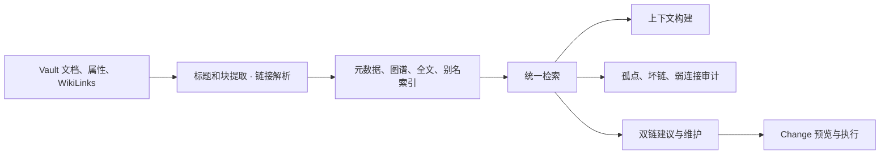
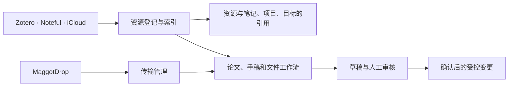

# 三个业务引擎

三个业务引擎共享 Vault、Change、备份和基础 ID 协议。外部 AI 经 POS CLI 调用业务操作，桌面端复用同一套 Rust API。 [原始设计](chatgpt-conversation://6b042ab3-2d74-83e9-b43c-60e79c21b064)

## 生产力

目标、里程碑、项目和任务组成长期路线图。日计划、日程、时间块和实际投入组成每日看板。四象限、估计学习和复盘使用这些数据的投影。 [生产力设计](productivity.md)

## 知识与检索

P0 提供元数据、图谱、全文检索和基础邻域、反链查询。P1 提供 AI 上下文、链接审计及受控维护。P2 扩展排序、候选关联解释和检索分析。该引擎管辖 Note、Link、Chunk 和 Context。

## 资源管理

P0 提供资源登记、MaggotDrop 接入和草稿区。P1 提供论文阅读、手稿回传及资源关联工作流。P2 扩展工作流编排、自动回传和跨来源检索。该引擎管辖 Resource、Transfer、Workflow 和 Draft。
