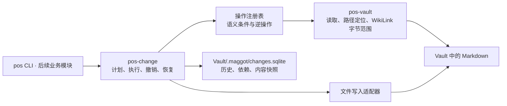

# Change Engine 设计

本规范定义独立的 Rust 模块 `pos-change`。AI 维护双链、用户调整目标和后续业务模块的受控操作都可以使用同一套变更协议。首版从单篇 Markdown 中的一处 WikiLink 变更开始，覆盖执行、历史、差异、撤销与中断恢复。

## 模块边界



- `pos-vault` 继续负责路径校验和 Markdown 解析。首版按需补充原始文件字节和 WikiLink 字节范围读取，并复用已有路径校验和链接解析。新的读取入口与已有 `read`、`scan` 和监听接口兼容。
- `pos-change` 统筹执行和恢复。操作处理器生成最小补丁和逆操作，文件写入适配器落实经过确认的写入。CLI 和桌面入口复用同一执行接口。
- 首版用 Rust 类型和进程内注册表按 `(kind, payload_version)` 分发。业务模块可以增加处理器。处理器定义读取和写入范围、前置条件，以及逆补丁或不可逆原因。执行器统一记录和校验这些信息。

## Change 模型

令 $\mathcal{S}$ 表示受管理的 Vault 文件状态。一个 Change 是带前置条件的偏函数 $c\colon\mathcal{S}\rightharpoonup\mathcal{S}$。条件成立时，执行器才有可应用的补丁。

| 记录 | 内容 |
| --- | --- |
| 标识与来源 | 全局唯一 `change_id`、`vault_id`、`actor_id`、可用时的 `device_id`、时间、本 Vault 的执行序号 `seq` |
| 操作 | `kind`、`payload_version`、类型化参数、目标和用户理由 |
| 实际效果 | 受影响的资源及范围、实际前后字节的 SHA-256、对应内容对象、重定位上下文和逆操作信息 |
| 关系 | `depends_on` 指向本次实际依赖的旧 Change，`reverts` 指向本次撤销的原 Change |

`seq` 提供本地提交后的浏览顺序。因果依赖单独记录，以有向无环图表达。新 Change 只引用同一 Vault 内已完成的旧 Change。同一文件中的两处独立补丁可以没有依赖关系。原位置失效时，用范围内容和上下文在当前字节中寻找唯一匹配。

处理器声明操作依赖的语义范围。执行器结合历史中仍生效的效果记录确定依赖，并在执行前复核。整篇文件的哈希用于确认预览和写入时的字节一致性，范围用来判断两条 Change 是否互相阻塞。

目标记录库内相对路径和可用的显式笔记 ID。没有显式 ID 的笔记沿用现有路径识别。外部重命名后身份无法确认时报告冲突。将来实现受控重命名时，可以在 Change 中记录旧路径、新路径和对象身份。

## 本地存储

```text
<vault>/
  .maggot/
    changes.sqlite
    write.lock
    staging/
```

- `changes.sqlite` 保存追加写入的历史及依赖、SHA-256 寻址的不可变内容对象，以及独立的执行中记录。数据库用同一事务保存内容对象和引用。首版保存所涉 Markdown 文件去重后的前后字节，用于生成差异和核对恢复状态。暂存目录容纳文件替换过程使用的临时数据。
- SQLite 结构版本和操作载荷版本各自管理。已有操作按其载荷版本解释。通用历史和前后差异可以直接读取效果记录。
- `.maggot` 是版本控制的专用持久化位置。笔记正文及业务属性以 Vault 的 Markdown 为当前数据。现有 Vault 扫描和普通笔记监听会跳过该隐藏目录。
- 首版按单设备本地存储设计。启用真实 Vault 时，确认 `.maggot` 的 Git 和文件同步排除范围。版本历史包含已被编辑或删除的原文。备份将 Vault 与数据库视为同一恢复集合，在明确的文件捕获边界内使用 SQLite Online Backup API 生成数据库副本。 [SQLite Online Backup API](https://sqlite.org/backup.html)

| 表 | 首版约束 |
| --- | --- |
| `vault_meta` | 保存 Vault ID 和数据格式信息 |
| `changes` | `change_id` 唯一，`seq` 按完成顺序增长，引用实际内容对象 |
| `change_dependencies` | 记录 Change 对同一 Vault 已完成旧 Change 的依赖 |
| `content_blobs` | SHA-256 为键，字节持久化后保持不可变 |
| `executions` | 按 `change_id` 唯一，保存批准范围、计划效果以及执行和恢复状态 |

## 执行与中断恢复

首版一个 Change 写一个已存在的 Markdown 文件。所有 Personal OS 写入口共用操作系统管理的 Vault 级文件锁，进程退出时释放。SQLite 事务保护数据库内部一致性，文件与数据库之间通过持久执行记录衔接。 [SQLite 原子提交](https://sqlite.org/atomiccommit.html)

1. **预览**。读取原始字节并校验路径和目标。处理器生成最小补丁、逆操作信息和前后哈希。确认绑定目标文件、具体补丁和输入哈希。初始化 `.maggot` 或执行补丁前，须就真实 Vault 的写入范围征得用户明确同意。
2. **准备**。获取写锁，重读文件并校验批准时的输入哈希。用 SQLite 事务保存前后字节与 `pending` 记录。每个 `change_id` 只有一份执行记录。
3. **写入**。在同一文件系统暂存新字节，校验目标仍在批准范围内，由文件适配器执行替换并验证写后哈希。应用锁只覆盖 Personal OS 写入者。真实写入须在可保证目标文件独占写入的窗口进行。外部编辑器或同步进程仍可能写入时返回冲突。哈希读取和文件替换是分开的操作。 [Windows 文件替换](https://learn.microsoft.com/en-us/windows/win32/api/winbase/nf-winbase-replacefilew)
4. **完成**。用 SQLite 事务追加不可变 Change、写入依赖并结束 `pending`。重试先查询已有执行状态，已完成时返回原结果。

重启发现 `pending` 时先恢复，再接受后续写入。恢复工具对比当前文件哈希和已存档的前后内容。恢复可补齐已经批准的历史记录，额外修改笔记需要另行确认。

| 当前状态 | 处理 |
| --- | --- |
| 匹配操作前哈希 | 结束待处理记录并标为未确认生效，原 Change 留在执行记录中 |
| 匹配操作后哈希，且能确认操作后的文件状态来自本次替换 | 追加原 Change，幂等地完成历史 |
| 匹配操作后哈希，期间的外部写入无法排除 | 保留待处理记录和内容，展示证据供用户确认归属 |
| 文件缺失、哈希不同或状态不可核对 | 保存冲突证据，暂停该目标的后续写入 |

Vault 监听可提示有变化。后续可基于已有可信基线和当前字节追加 `external.observe`，记录捕获到的字节和观察时间。缺少旧字节时，从观察到的新基线开始。

## 条件撤销

撤销在当前状态上计算逆补丁，成功后追加一条带 `reverts` 引用的 `change.revert`。执行器检查原效果仍可在当前文件中唯一定位、仍生效的变更中没有依赖原效果的操作，以及逆补丁只修改应撤销的部分。

例如，`C1` 把第一段的「配位平衡」改成 `[[配位平衡]]`，`C2` 在第二段添加另一条双链。撤销 `C1` 时，在当前文件定位第一段的匹配位置并移除其双链标记，第二段的改动保留。后续 Change 已改动该处链接目标，或当前上下文有多个候选时，预览返回冲突。用户仍可按 Change 查看原始差异和依赖链。

## 首版交付顺序

1. 实现 `pos-change` 的核心记录、SQLite 存储，以及 `list`、`show`、`diff` 的只读接口。写入测试使用临时 Vault。
2. 在 `pos-vault` 补齐原字节与链接范围读取。接入 `link.add`、`link.remove`、预览和单文件写入。执行入口由 `pos change` 和 `pos link` 调用。
3. 接入条件撤销与重启恢复。验收包括保留独立的后续改动、重复执行的幂等性、编辑冲突时保留现有文件、模拟替换前后中断，以及保留 BOM、换行和原有 Markdown 排版。

后续通过同一个处理器接口增加 YAML 属性或业务操作。多文件操作需要单独定义写入及恢复协议。跨设备同步可以复用 Vault ID、Change ID、依赖和内容哈希。
