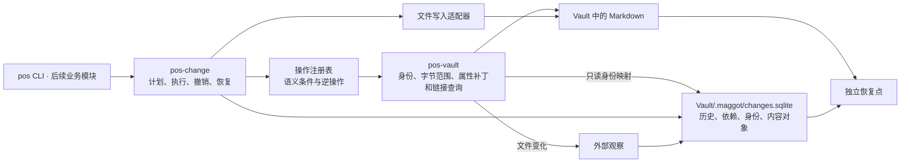

# Change Engine 设计

独立 Rust 模块 `pos-change` 为双链、文档、Markdown 字节范围和 YAML 属性提供受控变更。业务模块通过同一套协议注册操作，复用执行、历史、差异、撤销和恢复。

## CLI

以下命令使用已有示例笔记的测试 Vault。初始化后生成 JSON 预览，检查其中的补丁、目标和哈希，然后应用同一份预览文件。`--exclusive` 表示调用者已暂停会修改目标文件的编辑器和同步进程。

```powershell
pos change --root $exampleVault init
pos link --root $exampleVault add '笔记.md' --text '配位平衡' --target '配位平衡' --actor 'local' > add.json
pos change --root $exampleVault apply add.json --exclusive
pos change --root $exampleVault list
pos change --root $exampleVault show $changeId
pos change --root $exampleVault diff $changeId
pos change --root $exampleVault undo $changeId --actor 'local' > undo.json
pos change --root $exampleVault apply undo.json --exclusive
```

`pos link remove` 接受 `--link '[[目标|别名]]'`。预览在同一文件中找到多个匹配时，可用 `--offset` 指定原文件的 UTF-8 字节位置。现有链接、代码、注释和前置 YAML 不作为新链接的文本候选。撤销记录保留原操作，首版可通过新的正向操作重做。

`pos change preview <path> <kind> --payload <JSON> --actor <name>` 生成可应用的载荷。内置操作 `note.create` 接收 Markdown JSON 字符串，`markdown.replace` 接收 `start`、`end`、`text`，`property.set` 接收 `key`、`value`，`property.remove` 接收 `key`。范围以 UTF-8 字节计数，空范围用于插入。

`pos change recover` 只读列出待处理执行。用 `recover --resolve $changeId --exclusive` 结束匹配操作前哈希的记录。确认操作确实写入与操作后哈希一致的版本后，追加 `--accept-written` 完成历史。用 `--keep-current` 结束冲突或归属待确认的执行，保留笔记、冲突证据和版本对象，解除该文件的待处理锁定。

若 SQLite 提示上次中断后需要回滚日志，获准写入 `.maggot` 后可运行 `pos change init` 重新打开版本库。SQLite 完成自身事务恢复后，再检查待处理的 Markdown 变更。

## 模块边界



- `pos-vault` 负责路径校验、对象读取、正反向链接查询和最小 YAML 属性补丁。原始文件字节、标题、块与链接使用统一的字节范围。
- `pos-change` 统筹执行和恢复。操作处理器生成最小补丁和逆操作，文件写入适配器落实经过确认的写入。CLI 和桌面入口复用同一执行接口。
- 首版用 Rust 类型和进程内注册表按 `(kind, payload_version)` 分发。业务模块可以增加处理器。处理器定义读取和写入范围、前置条件，以及逆补丁或不可逆原因。执行器统一记录和校验这些信息。

## Change 模型

令 $\mathcal{S}$ 表示受管理的 Vault 文件状态。一个 Change 是带前置条件的偏函数 $c\colon\mathcal{S}\rightharpoonup\mathcal{S}$。条件成立时，执行器才有可应用的补丁。

| 记录 | 内容 |
| --- | --- |
| 标识与来源 | 全局唯一 `change_id`、`vault_id`、`actor_id`、可用时的 `device_id`、时间、本 Vault 的执行序号 `seq` |
| 操作 | `kind`、`payload_version`、类型化参数、目标和用户理由 |
| 实际效果 | 受影响的资源及范围、实际前后字节的 SHA-256、对应内容对象、重定位上下文和逆操作信息 |
| 关系 | `depends_on` 指向本次实际依赖的旧 Change，`reverts` 指向本次撤销的原 Change |

`seq` 提供本地提交后的浏览顺序。因果依赖单独记录，以有向无环图表达。新 Change 只引用同一 Vault 内已完成的旧 Change。同一文件中的两处独立补丁可以没有依赖关系。位置随已验证的字节变更链移动。外部改写使原位置无法证明时，撤销返回冲突。

处理器声明操作依赖的语义范围。执行器结合历史中仍生效的效果记录确定依赖，并在执行前复核。整篇文件的哈希用于确认预览和写入时的字节一致性，范围用来判断两条 Change 是否互相阻塞。

目标记录库内相对路径和逻辑笔记 ID。Vault 识别同卷重命名，Change 完成时把替换后的文件身份绑定到原逻辑 ID。历史按 ID 查找笔记。版本库 v1 会在获准写入时迁移到 v2，既有路径型 ID 的历史仍受原路径约束。

## 本地存储

```text
<vault>/
  .maggot/
    changes.sqlite
    write.lock
    staging/
```

- `changes.sqlite` 保存追加写入的历史及依赖、SHA-256 寻址的不可变内容对象，以及独立的执行中记录。数据库用同一事务保存内容对象和引用。首版保存所涉 Markdown 文件去重后的前后字节，用于生成差异和核对恢复状态。暂存目录容纳文件替换过程使用的临时数据。
- SQLite 结构版本和操作载荷版本各自管理。已有操作按其载荷版本解释。通用历史和前后差异可以直接读取效果记录。
- `.maggot` 是版本控制的专用持久化位置。笔记正文及业务属性以 Vault 的 Markdown 为当前数据。现有 Vault 扫描和普通笔记监听会跳过该隐藏目录。
- 首版按单设备本地存储设计。启用真实 Vault 时，确认 `.maggot` 的 Git 和文件同步排除范围。版本历史包含已被编辑或删除的原文。备份将 Vault 与数据库视为同一恢复集合，在明确的文件捕获边界内使用 SQLite Online Backup API 生成数据库副本。 [SQLite Online Backup API](https://sqlite.org/backup.html)

| 表 | 首版约束 |
| --- | --- |
| `vault_meta` | 保存 Vault ID 和数据格式信息 |
| `changes` | `change_id` 唯一，`seq` 按完成顺序增长，引用实际内容对象 |
| `change_dependencies` | 记录 Change 对同一 Vault 已完成旧 Change 的依赖 |
| `content_blobs` | SHA-256 为键，字节持久化后保持不可变 |
| `executions` | 按 `change_id` 唯一，保存批准范围、计划效果以及执行和恢复状态 |
| `execution_conflicts` | 保存结案原因及可读取的现有字节哈希 |
| `note_bindings` | 将物理文件身份映射到逻辑笔记 ID |
| `observed_notes` | 保存最近一次捕获的笔记路径、身份与内容哈希 |

## 执行与中断恢复

每个 Change 作用于一个 Markdown 文件，可创建文件、修改已有内容或撤销新建。受控写入口共用操作系统管理的 Vault 级文件锁。SQLite 保护数据库内部一致性，文件与数据库之间通过持久执行记录衔接。 [SQLite 原子提交](https://sqlite.org/atomiccommit.html)

1. **预览**。读取原始字节并校验路径和目标。处理器生成最小补丁、逆操作信息和前后哈希。确认绑定目标文件、具体补丁和输入哈希。初始化 `.maggot` 或执行补丁前，须就真实 Vault 的写入范围征得用户明确同意。
2. **准备**。获取写锁，重读文件并校验批准时的输入哈希。用 SQLite 事务保存前后字节与 `pending` 记录。每个 `change_id` 只有一份执行记录。
3. **写入**。在同一文件系统暂存新字节，校验目标仍在批准范围内，由文件适配器执行替换并验证写后哈希。应用锁只覆盖 Personal OS 写入者。真实写入须在可保证目标文件独占写入的窗口进行。外部编辑器或同步进程仍可能写入时返回冲突。哈希读取和文件替换是分开的操作。 [Windows 文件替换](https://learn.microsoft.com/en-us/windows/win32/api/winbase/nf-winbase-replacefilew)
4. **完成**。用 SQLite 事务追加不可变 Change、写入依赖并结束 `pending`。重试先查询已有执行状态，已完成时返回原结果。

重启发现 `pending` 时先恢复，再接受后续写入。恢复工具对比当前文件哈希和已存档的前后内容。恢复可补齐已经批准的历史记录，额外修改笔记需要另行确认。

| 当前状态 | 处理 |
| --- | --- |
| 匹配操作前哈希 | 结束待处理记录并标为未确认生效，原 Change 留在执行记录中 |
| 匹配操作后哈希，且用户确认操作后的文件状态来自本次替换 | 追加原 Change，幂等地完成历史 |
| 匹配操作后哈希，归属仍待确认 | 保留待处理记录和内容，展示当前哈希和暂存证据 |
| 不符合预期的文件缺失、哈希不同或状态不可核对 | 暂停该文件的后续写入，待人工确认后可保留当前文件并结案 |

`pos change observe --actor external` 建立或刷新基线，追加已观察到的外部新增、编辑、重命名和删除。加 `--watch` 可持续观察。受控写入也会记录已有基线与预览之间已经发生的外部变化。历史记录捕获到的状态和观察时间。多次快速外部保存可能被文件通知合并。

## 条件撤销

撤销在当前状态上计算逆补丁，成功后追加一条带 `reverts` 引用的 `change.revert`。执行器检查原效果仍可在当前文件中唯一定位、仍生效的变更中没有依赖原效果的操作，以及逆补丁只修改应撤销的部分。

例如，`C1` 把第一段的「配位平衡」改成 `[[配位平衡]]`，`C2` 在第二段添加另一条双链。撤销 `C1` 时，在当前文件定位第一段的匹配位置并移除其双链标记，第二段的改动保留。后续 Change 已改动该处链接目标，或当前上下文有多个候选时，预览返回冲突。用户仍可按 Change 查看原始差异和依赖链。

## 一致性恢复点

```powershell
pos backup create --root $exampleVault $archive --exclusive
pos backup verify $archive
pos backup restore $archive $newVault
```

创建时暂停整个 Vault 的外部写入，持有应用锁并比对捕获前后的文件清单。归档包含笔记、附件、配置和 SQLite 一致性副本，跳过 Git 元数据、锁和数据库日志文件。校验验证 SHA-256、SQLite 完整性、外键和历史边界。恢复写到全新目录，保留已纳入版本记录的笔记身份。正式 Vault 启用写入前，应在独立位置完成其实际备份与恢复演练。
