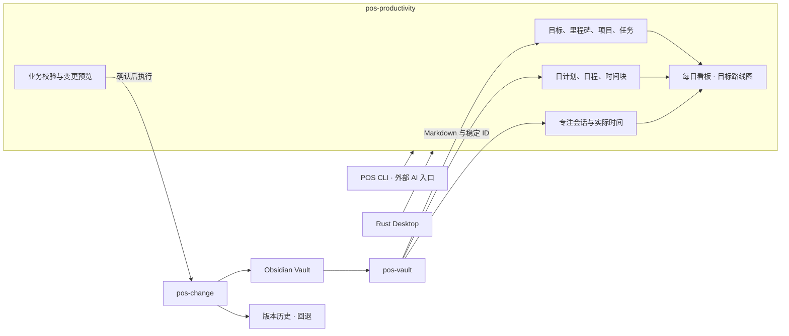

# 生产力引擎

效率系统将目标、计划、执行和实际投入连成一条流程。首版覆盖原设计的 P0，并以日程与每日看板作为日常入口。 [原始设计](chatgpt-conversation://6b042ab3-2d74-83e9-b43c-60e79c21b064)



## 数据与日程

Goal 与 Project 多对多。Milestone 属于 Goal，Project 可关联多项 Milestone 与 Goal。Task 可独立存在，也可引用 Project、Goal、Milestone 和前置任务。Daily Plan 引用 Task，并单独保存重点、预算和当日结案决定。Event 与 TimeBlock 记录计划时间，TimeEntry 记录实际发生的区间。Daily Board 按日期聚合，不另存一份任务数据。

| 实体 | 新建位置 | 首版用途 |
| --- | --- | --- |
| Goal、Milestone | `Life/Goal` | 长期焦点、当前阶段、路线图 |
| Project、Task | `Life/Project` | 项目归属、任务池、执行状态与依赖 |
| Daily Plan、Event、TimeBlock | `Life/Plan` | 优先任务、历史日期、计划时间轴与冲突 |
| TimeEntry | `Journal` | 手工时间记录与持久化专注会话 |

受管文档通过显式 `id`、`type` 和 `pos_productivity` 属性识别。标题与类型化字段保存在 `pos_productivity`，正文保留给 Obsidian 使用。已有普通笔记可以与这些文档并存。创建时要求相应目录已存在。日计划使用确定性文件名，一个日期保留一份计划。

日期采用 ISO 日期。时刻保存为带偏移的时间，按看板指定的 IANA 时区计算日界线。默认时区为 `Asia/Shanghai`。跨午夜区间按日界线裁剪，实际时间使用区间并集统计。

专注的开始、暂停、继续和结束保存在同一份 TimeEntry。日计划结案时为未完成任务记录改期、退回任务池或取消当日安排。改期在目标日期的看板上投影为对原任务的引用。

## 事务与后续范围

业务层读取 Vault，校验引用、状态和时间范围，然后生成 Change 预览。应用前在 Change 文件锁内再次校验业务约束与预览。计划与实际时间分别保存，原计划和后续调整可由 Change 历史追查。

P1 保留动态优先级、四象限、个人时间估计学习和周月复盘。估计学习以任务初始估计、修订原因和相关 TimeEntry 为输入。P2 保留自动排程、预算优化和趋势分析。外部资源及知识成果由各自引擎提供。

开发验证使用临时 Vault。真实 Vault 按项目约定在完成独立备份恢复验证并取得明确同意后开放写入。

## 使用

桌面端默认打开每日看板。输入 Vault 根目录后，可以切换日期和时区、新建与安排任务、编辑计划、记录实际时间和运行专注计时。目标路线图和项目页读取同一组文档。写入前显示 Change 的目标与前后内容。测试 Vault 可通过 `pos change --root $vault init` 初始化版本库。

启动桌面端时可以通过进程环境变量 `POS_VAULT_ROOT` 指定默认读取的 Vault。一份已打开的窗口可通过路径栏切换。

```powershell
pos productivity --root $vault list --kind task
pos productivity --root $vault roadmap
pos productivity --root $vault day --date 2026-11-25 --timezone Asia/Shanghai
pos productivity --root $vault preview task.json --actor local > preview.json
pos productivity --root $vault apply preview.json --exclusive
```

`task.json` 示例

```json
{"action":"create","item":{"type":"task","title":"阅读论文","status":"todo","initial_estimate_minutes":60}}
```

CLI 预览接受 `create`、`edit`、`set_task_status`、`schedule_task`、`close_day` 及 `focus_start`、`focus_pause`、`focus_resume`、`focus_stop`。引用使用通过 `list` 或 `show` 获得的 UUID。手工用时使用 `time_entry` 类型及带开始和结束的 `intervals`。可通过 Change 历史查询调整前后的内容。

按日期查看时会显示该日保存的计划与实际记录，任务卡使用当前任务状态。按时点重放整个历史看板、拖拽排程、自定义布局和跨引擎成果聚合随后续优先级保留。
