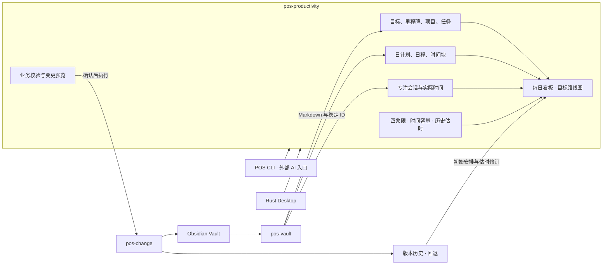

# 生产力引擎

效率系统将目标、计划、执行和实际投入连成一条流程。每日看板包含执行看板、时间轴和规划分析。 [原始设计](chatgpt-conversation://6b042ab3-2d74-83e9-b43c-60e79c21b064)



## 数据与日程

Goal 与 Project 多对多。Milestone 属于 Goal，Project 可关联多项 Milestone 与 Goal。Task 可独立存在，也可引用 Project、Goal、Milestone 和前置任务。Daily Plan 引用 Task，并单独保存重点、预算和当日结案决定。Event 与 TimeBlock 记录计划时间，TimeEntry 记录实际发生的区间。Daily Board 按日期聚合，不另存一份任务数据。

| 实体 | 新建位置 | 首版用途 |
| --- | --- | --- |
| Goal、Milestone | `Life/Goal` | 长期焦点、当前阶段、路线图 |
| Project、Task | `Life/Project` | 项目归属、任务池、执行状态与依赖 |
| Daily Plan、Event、TimeBlock | `Life/Plan` | 优先任务、历史日期、计划时间轴与冲突 |
| TimeEntry | `Journal` 或所属任务的专注记录 | 手工补录、旧版会话和任务内计时使用同一套区间统计 |

受管文档通过显式 `id`、`type` 和 `pos_productivity` 属性识别。标题与类型化字段保存在 `pos_productivity`，正文保留给 Obsidian 使用。已有普通笔记可以与这些文档并存。创建时要求相应目录已存在。日计划使用确定性文件名，一个日期保留一份计划。

日期采用 ISO 日期。时刻保存为带偏移的时间，按看板指定的 IANA 时区计算日界线。默认时区为 `Asia/Shanghai`。跨午夜区间按日界线裁剪，实际时间使用区间并集统计。

新专注会话随任务保存在 Markdown 属性中，开始时任务进入「进行中」。最后一个检查点完成时，同一次 Change 会完成任务并结束计时。旧版独立会话仍可暂停、继续和结束。有旧版会话正在运行时，先结束该会话即可完成任务。日计划结案时可将未完成任务改期、退回任务池或取消当日安排。

前置任务完成后，后续任务自动进入可执行范围。每日看板优先推荐当前时间块的任务，其次考虑进行中的任务、当日重点、紧迫程度和截止时间。当天任务均不可执行时，可从待安排清单推荐已就绪的任务。首个检查点勾选后任务进入进行中，撤回已完成任务的检查点会重新打开任务。如果后续任务已经开始，需先将后续任务退回待办或取消。

## 进度与规划分析

- 项目、里程碑和目标实时汇总关联任务与检查点，排除已取消的任务，同一任务通过多条路径关联目标时只计一次。里程碑的验收状态由用户确认。
- 时间轴以日界线对齐。初始安排取各日程和时间块首次受控保存的区间，计划任务名单取日计划首次受控保存的内容。当前计划读取现有文档。实际记录来自 TimeEntry，跨任务重叠的部分在时间分布中单列。没有创建历史的外部记录从当前轨开始显示。
- 剩余估算为当前总耗时估算减去任务累计实际投入。未完成任务耗尽估时时进入「待重估」，可填写还需要的分钟数；保留初始估算和修订原因。当所有未完成任务都有有效估算时，工作负荷按剩余工作量除以可用容量计算。当天容量考虑可工作时段、固定日程、缓冲和分钟预算。
- 四象限默认阈值为重要性 70、紧迫度 0.70，可在日计划中调整。任务显式截止优先，其次取里程碑、后续任务截止、时间块结束和计划日结束的最早值。时间容量扣除固定日程、其他任务的时间块和缓冲。截止前存在未配置工作时段的日期时，界面将相应任务标记为待补充。可为重要且从容的任务设置战略时间目标。
- 历史估时按任务类别统计实际投入与初始估算的比值。P50、P80、P95 分别至少需要 5、10、20 个样本。实际用时区间去重，用户可以排除范围变更或记录不完整的任务。当前估算的修订原因随 Change 保存，并在看板中展示。校正后的分位值用于工作量规划。

## 事务与后续范围

业务层读取 Vault，校验引用、状态和时间范围，然后生成 Change 预览。应用前在 Change 文件锁内再次校验业务约束与预览。计划与实际时间分别保存，原计划和后续调整可由 Change 历史追查。

周月复盘、跨引擎成果聚合、自动排程和多变量耗时预测保留在后续范围。

开发验证使用临时 Vault。真实 Vault 按项目约定在完成独立备份恢复验证并取得明确同意后开放写入。

## 使用

桌面端默认打开每日看板。输入 Vault 根目录后，可以切换日期和时区、新建与安排任务、编辑计划、记录实际时间和运行专注计时。目标路线图和项目页读取同一组文档。写入前显示 Change 的目标与前后内容。测试 Vault 可通过 `pos change --root $vault init` 初始化版本库。

启动桌面端时可以通过进程环境变量 `POS_VAULT_ROOT` 指定默认读取的 Vault。一份已打开的窗口可通过路径栏切换。

```powershell
pos productivity --root $vault list --kind task
pos productivity --root $vault roadmap
pos productivity --root $vault day --date 2026-11-25 --timezone Asia/Shanghai
pos productivity --root $vault preview task.json --actor local > preview.json
pos productivity --root $vault apply preview.json --exclusive
```

`task.json` 示例

```json
{"action":"create","item":{"type":"task","title":"阅读论文","status":"todo","initial_estimate_minutes":60}}
```

CLI 预览接受 `create`、`edit`、`set_task_status`、`set_checkpoint`、`schedule_task`、`close_day` 及 `focus_start`、`focus_pause`、`focus_resume`、`focus_stop`。引用使用通过 `list` 或 `show` 获得的 UUID。手工用时使用 `time_entry` 类型及带开始和结束的 `intervals`。可通过 Change 历史查询调整前后的内容。

过去日期默认显示日终快照。引擎按所选时区次日零点截断 Change 历史，从当时最后一次已记录版本重建任务、检查点、计划和用时。此前尚未纳入版本管理的笔记可在「查看事后补录」或 CLI 的 `day --latest` 中查看。CLI 的 `reestimate_remaining` 接受任务 ID 和剩余分钟数。拖拽排程、自定义布局和跨引擎成果聚合保留在后续范围。
